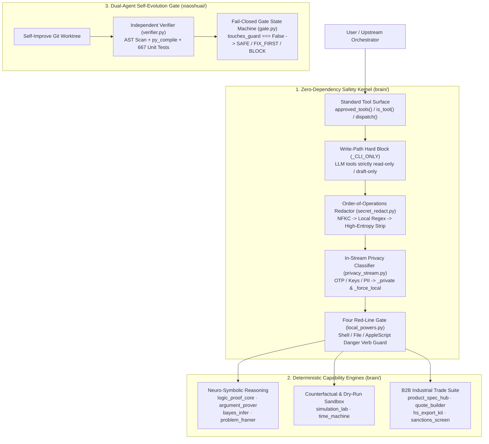

# Jarvis Core (`jarvis-core`)

[](https://github.com/OWAngel/jarvis-core/actions/workflows/ci.yml)
[](https://www.python.org/)
[-brightgreen.svg)](#)
[](LICENSE)

**Zero-Dependency Local-First AI Agent Safety Kernel · Self-Evolving Guardian Gate (Xiaoshuai) · In-Stream Privacy Router · Neuro-Symbolic Reasoning & B2B Trade Suite**

[English](#english-overview) | [中文说明](#中文说明)

---

<a id="english-overview"></a>

## English Overview

**`jarvis-core`** is an industrial-grade, local-first AI Agent safety kernel and deterministic capability suite written in **100% pure Python standard library (`sqlite3`, `ast`, `decimal`, `urllib`, `re`, `unicodedata`)** with **zero third-party runtime dependencies**.

While most agent frameworks focus on prompt wrappers and fragile dependency chains, `jarvis-core` solves the four hardest production problems of autonomous agents:
1. **Execution Safety & AST Self-Auditing**: How to let an LLM call local tools without risking destructive shell commands, silent credential leaks, or unauthorized state mutations.
2. **Fail-Closed Self-Evolution (`xiaoshuai`)**: How to let a coding agent evolve its own codebase in isolated Git worktrees while an independent guardian agent verifies compilation, tests, and security boundaries before merging.
3. **In-Stream Privacy & Cloud/Local Routing**: How to scan tool outputs in real time for high-entropy secrets, OTPs, and PII, automatically switching inference to an on-device model (`_force_local`) when sensitive data appears.
4. **Neuro-Symbolic Verification & Industrial Precision**: Deterministic engines for formal logic proof, exact Bayesian inference, counterfactual replay, and `Decimal`-exact B2B trade orchestration.

---

### System Architecture



---

### Four Core Pillars

#### 1. Zero-Dependency Agent Safety Kernel (`brain/local_powers.py`, `secret_redact.py`, `privacy_stream.py`, `config.py`)
- **Four Red-Line Confirmation Gate (`local_powers.py`)**: Intercepts destructive shell commands (`rm -rf`, disk formatting, privilege escalation), protected path writes, and dangerous macOS `osascript` (AppleScript) verbs (`delete`, `remove`, `send`, `keystroke`, `do shell script`) unless explicitly approved by a human confirmation token.
- **Write-Path `_CLI_ONLY` Iron Law & AST Static Self-Scan**: Every capability module exposes a strict three-piece interface (`approved_tools()`, `is_tool()`, `dispatch()`). State-mutating actions are hard-blocked inside `dispatch()` via `_CLI_ONLY`, and verified by built-in Python `ast` scanners that forbid `subprocess`, `os.system`, or literal `confirmed=True` in capability modules.
- **In-Stream Privacy Router (`privacy_stream.py` & `secret_redact.py`)**: Normalizes text via `NFKC` (preventing full-width/homoglyph bypasses), strips credentials (`sk-*`, `ghp_*`, `AKIA*`, PEM keys, high-entropy base64 tokens), and tags tool outputs with `_private` / `_force_local` to route sensitive turns to local LLMs.
- **Write-Locked Configuration (`config.py`)**: Hot-reloading TOML parser where `[safety]` and `[credentials]` sections are programmatically write-locked (`PermissionError` on mutation attempts).

#### 2. "Xiaoshuai" Dual-Agent Self-Evolution Guardian (`xiaoshuai/`)
- **Isolated Worktree Verification (`verifier.py`, `gate.py`)**: Designed for self-evolving agents that write new capabilities in isolated `git worktree` branches.
- **Fail-Closed Verdict State Machine**: Evaluates diffs against security red lines (`touches_guard` must be explicitly `False`, never truthy or `None`), runs syntax compilation and test suites, and emits deterministic verdicts (`SAFE`, `FIX_FIRST`, `BLOCK`, or human escalation).

#### 3. Neuro-Symbolic Reasoning & Counterfactual Simulation (`brain/`)
- **Action Simulation Lab (`simulation_lab.py`) & Time Machine (`time_machine.py`)**: Evaluates blast radius, reversibility, and risk scores before executing multi-step plans; replays historical trajectories under counterfactual parameters.
- **Formal Logic & First-Order Prover (`logic_proof_core.py`, `argument_prover.py`)**: Syllogism validity checker, 7-category logical fallacy detector, and natural-language-to-clause resolution prover.
- **Exact Bayesian Network & Problem Framing (`bayes_infer.py`, `problem_framer.py`)**: Pure-stdlib exact posterior inference over DAGs and structured root-cause decomposition.

#### 4. B2B Industrial Trade & Compliance Suite (`brain/`)
- **Technical Specification Knowledge Graph (`product_spec_hub.py`)**: Models multi-grade industrial material datasheets (TDS), normalizes SKUs (`m 996` / `M.996` → `M996`), extracts parameters with polarity rules, and enforces hard application-compatibility guardrails.
- **Inquiry-to-Quote Orchestrator (`quote_builder.py`)**: Extracts inquiry entities, matches product grades, computes `Decimal`-exact FOB/CIF/CFR pricing with tax rebates and container freight, and generates zero-auto-send email drafts.
- **HS Export Compliance & Sanctions Screening (`hs_export_kit.py`, `sanctions_screen.py`)**: Offline HS code lookup, country-specific customs document checklists (`FORM E`, `REACH`, `L/C` rules), certificate expiry ledger, and offline fuzzy screening against international sanctions lists.

---

### Quickstart & Code Examples

#### Run the Full Verification Suite (Zero Install Required)

```bash
# 1. Syntax compile gate across all modules (Pure Python 3.9+ stdlib)
python3 -m py_compile brain/*.py xiaoshuai/*.py xiaoshuai/tests/*.py

# 2. Run built-in AST & invariant selftests
PYTHONPATH=brain python3 brain/product_spec_hub.py selftest
PYTHONPATH=brain python3 brain/hs_export_kit.py selftest
PYTHONPATH=brain python3 brain/quote_builder.py selftest
PYTHONPATH=brain python3 brain/sanctions_screen.py selftest

# 3. Run all 667 unit tests (via pytest or unittest)
for f in brain/test_*.py; do
    PYTHONPATH=brain python3 -m pytest "$f" -q
done
PYTHONPATH=xiaoshuai:brain python3 -m pytest xiaoshuai/tests/ -q
```

#### Example 1: 4-Red-Line Guard & In-Stream Privacy Classification

```python
import sys
sys.path.insert(0, "brain")

import local_powers
import privacy_stream

# 1. Destructive shell command is intercepted before execution
res = local_powers.run_shell("rm -rf ~/important_data", confirmed=False)
print(res["blocked"], res["reason"])
# -> True, Blocked by Red-Line Guard

# 2. In-stream privacy scanner detects secrets/OTP and forces local LLM routing
scan = privacy_stream.scan("Customer API key sk-proj-ABCDEF1234567890XYZ, verification OTP: 839201")
print(scan["is_private"], scan["force_local"])
# -> True, True
```

#### Example 2: Industrial Spec Matching & Hard Incompatibility Guardrail

```python
import tempfile, os, sys
sys.path.insert(0, "brain")
import product_spec_hub as psh

db = os.path.join(tempfile.mkdtemp(), "spec.db")

# Ingest an outdoor-grade homopolymer resin (M-996) and an indoor-only copolymer (A-100)
psh.ingest_spec(
    model="M-996",
    text="高耐候型 户外涂料专用 PC2含量≥98% 白度96",
    category="工业树脂",
    certs=["REACH", "RoHS"],
    source="spec_sheet",
    db_path=db,
)
psh.ingest_spec(
    model="A-100",
    text="通用型 PC2含量98% 不能用于户外",
    category="工业树脂",
    scenarios=[{"kind": "forbidden", "scenario": "户外"}],
    attrs=[{"name": "晶型", "value": "通用型"}],
    source="spec_sheet",
    db_path=db,
)

# Match against an outdoor customer requirement: M-996 qualifies, A-100 is hard-disqualified
match = psh.requirement_match("户外涂料 要高耐候型 PC2≥98% 白度≥95 REACH", db_path=db)
print("Qualified:", [m["model"] for m in match["qualified"]])       # -> ['M-996']
print("Disqualified:", [m["model"] for m in match["disqualified"]]) # -> ['A-100']
```

---

<a id="中文说明"></a>

## 中文说明

`jarvis-core` 是一套 **100% 基于 Python 标准库（Zero Third-Party Runtime Dependencies）** 构建的本地优先 AI Agent 核心安全底座与工业级实战套件。它剥离了传统 Agent 框架臃肿的依赖链，提供经过 **667 项离线单元测试** 与 **AST 静态安全门**验证的四大核心能力层：

### 1. 零依赖 Agent 安全内核 (`brain/local_powers.py`, `secret_redact.py`, `privacy_stream.py`)
- **4 红线确认门 (Four Red-Line Confirmation Gate)**：在执行任何 Shell 命令、文件覆写或 macOS `osascript`（AppleScript）动作前，进行正则与语义双重拦截（涵盖 `rm -rf`、系统敏感目录写保护、AppleScript `delete`/`send`/`keystroke` 危险动词分级）。
- **写操作 `_CLI_ONLY` 铁律与 AST 静态自检**：所有能力模块严格遵循 `approved_tools()` / `is_tool()` / `dispatch()` 三件套协议；产生外部副作用或状态变更的动作硬编码进 `_CLI_ONLY` 集合，并在测试中通过 Python `ast` 语法树静态扫描禁止任何模块私自调用 `subprocess` 或硬编码 `confirmed=True`。
- **流式敏感度嗅探与端云切流 (`privacy_stream.py`)**：经 `NFKC` 归一化后在工具返回流中实时识别高熵密钥、OTP 验证码、银行卡号、身份证号与敏感文件路径，命中即触发 `_force_local` 信号将当轮推理无缝切回本地模型。

### 2. 「小帅」双 Agent 自我进化守门人 (`xiaoshuai/`)
- **Worktree 隔离验证 + 守门状态机 (`gate.py` / `verifier.py`)**：当自我进化 Agent 在独立 `git worktree` 中生成新代码与测试后，必须通过独立守门人 `xiaoshuai` 的编译、测试与红线触碰检查（`touches_guard` 必须显式为 `False`，默认 Fail-Closed），仅在获得 `SAFE` 裁决后才允许合入主分支。

### 3. B2B 制造业与国际贸易实战套件 (`brain/quote_builder.py`, `sanctions_screen.py`, `hs_export_kit.py`, `product_spec_hub.py`)
- **外贸阶梯报价工坊 (`quote_builder.py`)**：基于 `decimal.Decimal` 精确核算 FOB / CIF / CFR 多币种阶梯报价、海运费、港杂费与毛利红线，内置询盘要素抽取与零自动发送邮件草稿生成。
- **离线国际制裁名单筛查 (`sanctions_screen.py`)**：纯标准库 + SQLite 实现的多源国际制裁实体模糊匹配与合规审计。
- **HS 出口单证合规包 (`hs_export_kit.py`)**：出口 HS 编码校验、REACH / RoHS / HALAL 证书有效期台账与报关单证清单核对。
- **产品规格中枢 (`product_spec_hub.py`)**：工业牌号 TDS 理化指标建模、SKU 归一化、客户需求匹配与禁配场景硬拦截引擎。

### 4. 可解释推理与反事实仿真内核 (`brain/simulation_lab.py`, `time_machine.py`, `logic_proof_core.py`, `argument_prover.py`, `problem_framer.py`, `bayes_infer.py`)
- **行动仿真沙盒 (`simulation_lab.py`)** 与 **反事实时间机器 (`time_machine.py`)**：在 Agent 执行多步计划前进行爆炸半径评估、风险打分与历史轨迹回放比较。
- **形式逻辑与贝叶斯推理 (`logic_proof_core.py`, `argument_prover.py`, `problem_framer.py`, `bayes_infer.py`)**：三段论有效性检验、7 类逻辑谬误扫描、一阶谓词归结证明、问题重构与纯标准库精确贝叶斯网络推断。

---

## Repository Layout (目录结构)

```text
jarvis-core/
├── .github/workflows/ci.yml         # Dual Python (3.9 / 3.12) compile + test matrix
├── brain/
│   ├── config.py                    # Zero-dep TOML config with [safety]/[credentials] write-locks
│   ├── local_powers.py              # 4-red-line guard + AppleScript danger verb interceptor
│   ├── privacy_stream.py            # In-stream privacy classifier & local-LLM router
│   ├── secret_redact.py             # Recursive high-entropy credential & PII redactor
│   ├── product_spec_hub.py          # Industrial TDS knowledge graph & compatibility engine
│   ├── quote_builder.py             # Decimal-exact FOB/CIF B2B quote orchestrator
│   ├── hs_export_kit.py             # HS code lookup, customs checklist & cert expiry ledger
│   ├── sanctions_screen.py          # Offline fuzzy sanctions screening engine
│   ├── simulation_lab.py            # Pre-action dry-run sandbox & blast-radius scorer
│   ├── time_machine.py              # Counterfactual replay & timeline diff engine
│   ├── logic_proof_core.py          # Syllogism validator & 7-category fallacy scanner
│   ├── argument_prover.py           # Natural-language first-order resolution prover
│   ├── problem_framer.py            # Structured problem reframing & root-cause engine
│   ├── bayes_infer.py               # Pure-stdlib exact Bayesian network inference
│   └── test_*.py                    # 621 offline unit tests + AST security gate checks
└── xiaoshuai/
    ├── gate.py                      # Self-evolution guardian state machine (SAFE/FIX_FIRST/BLOCK)
    ├── verifier.py                  # Isolated git worktree verifier
    ├── approval_policy.py           # Action risk-tier policy engine
    └── tests/                       # 46 guardian unit tests
```

## License

Released under the [MIT License](LICENSE).
